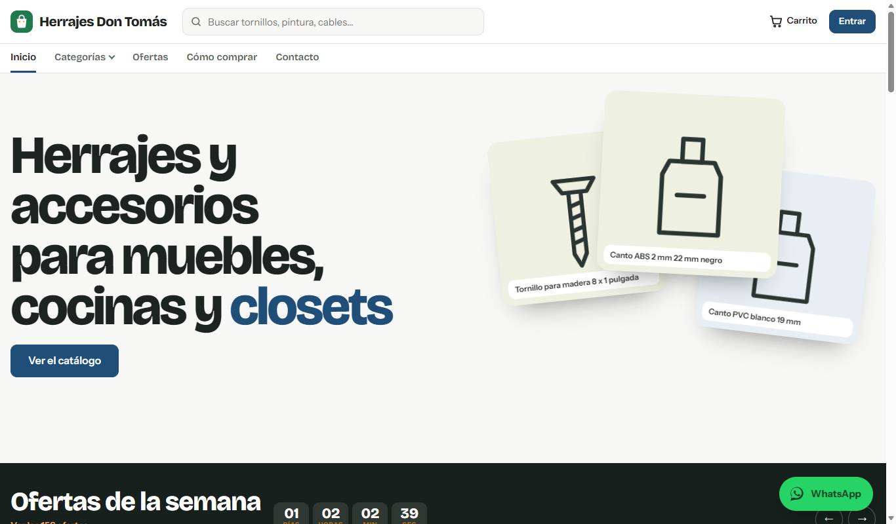
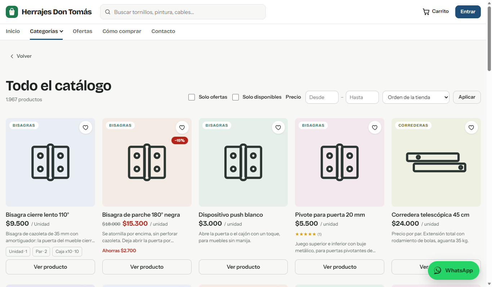
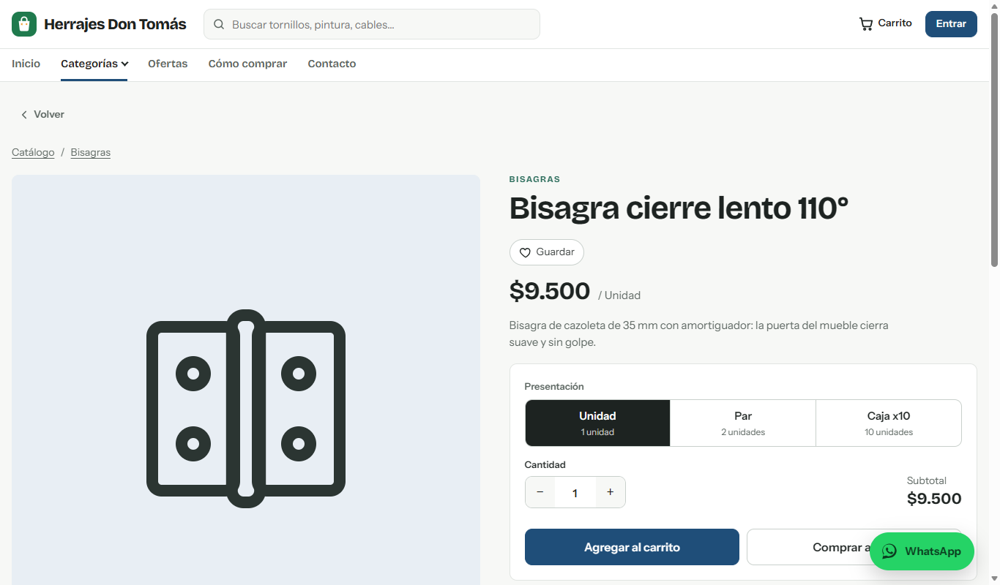
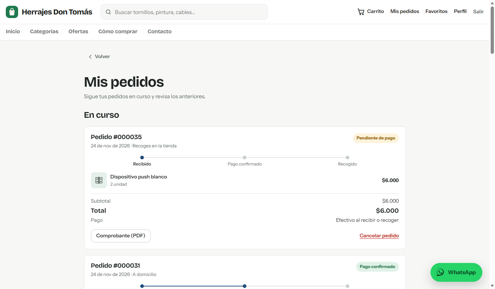
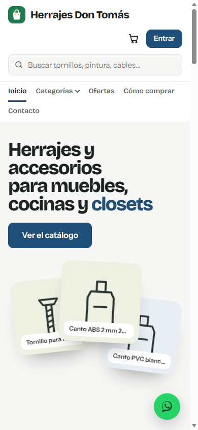
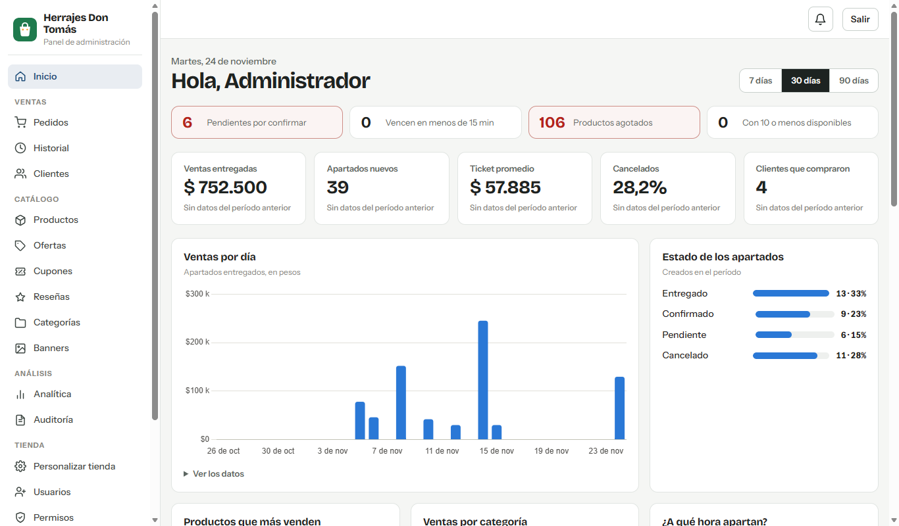
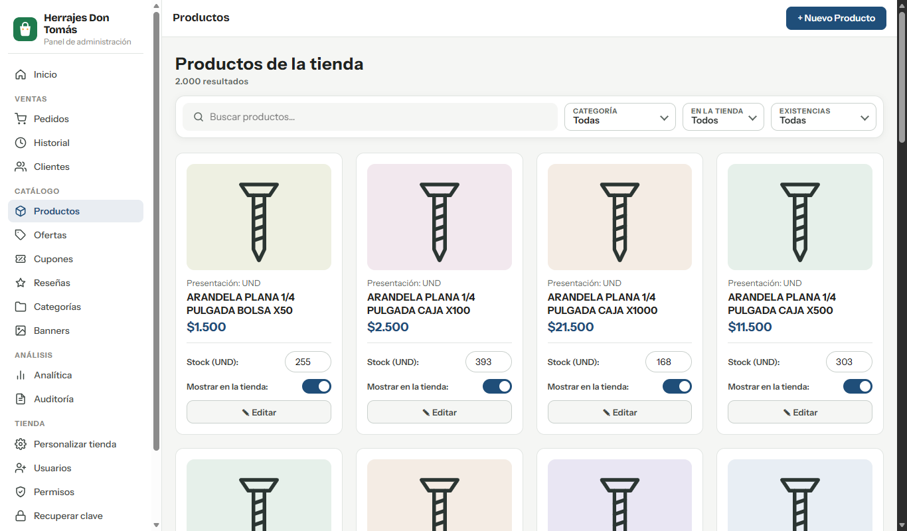

# 🛒 Marketplace

**Tienda en línea con pedidos, pagos en tienda y panel de administración, lista para tu negocio.**

Tus clientes exploran el catálogo, hacen su pedido en segundos y pagan en efectivo, transferencia, Nequi, Daviplata o datáfono. Tú administras productos, ofertas, pedidos, clientes e inventario desde un panel con estadísticas.

> 💡 **Ideal para:** ferreterías, tiendas de barrio, distribuidoras, fruvers y cualquier negocio que quiera vender en línea hoy.

> Este repositorio es solo una **presentación** del producto. El código fuente es privado y se entrega con una licencia comercial.

---

## 📸 Capturas

*Tienda demo "Herrajes Don Tomás" con 2.000 productos.*

### Tienda

| Catálogo con filtros | Detalle del producto |
| :---: | :---: |
|  |  |

| Mis pedidos (cliente) | En el celular |
| :---: | :---: |
|  |  |

### Panel de administración

| Inicio con estadísticas | Productos e inventario |
| :---: | :---: |
|  |  |

---

## 🚀 Qué incluye

| Función | Descripción |
| --- | --- |
| 🛍️ **Catálogo** | Búsqueda, categorías, filtros por precio, ofertas y disponibilidad; miles de productos con paginación |
| 🧾 **Pedidos con número** | Carrito → pedido (#000123) con seguimiento por pasos y comprobante en PDF |
| 💳 **Formas de pago** | Efectivo, transferencia, Nequi, Daviplata o datáfono; la tienda confirma el pago |
| 🚚 **Envío a domicilio** | Tarifa configurable y envío gratis desde un monto |
| 🎟️ **Cupones** | Porcentaje o valor fijo, compra mínima, usos máximos y vencimiento |
| 📦 **Presentaciones** | Vende por unidad, par, caja, etc., configurable por producto |
| ❤️ **Favoritos y "avísame"** | Aviso al cliente cuando un producto agotado vuelve a tener stock |
| ⭐ **Reseñas** | Solo de clientes que recibieron el producto, con moderación |
| 📊 **Panel con estadísticas** | Ventas por día, productos más vendidos, mejores clientes y visitas |
| 🔐 **Usuarios y permisos** | Administrador, empleados con permisos por sección, y clientes |
| ⚡ **Inventario real** | El stock se descuenta al confirmar el pago y se libera si el pedido se cancela |
| ⚖️ **Páginas legales** | Términos, privacidad (Ley 1581) y devoluciones (Ley 1480), editables |
| 🔗 **Punto de venta** | Puede compartir la base de datos con el POS de la tienda |
| 📱 **Responsive** | Funciona en escritorio y celular |

---

## 🛠️ Tecnologías

Node.js + Express · EJS · MySQL · sesiones con roles y protección CSRF.

---

## 💼 Cómo adquirirlo

El código se entrega con licencia comercial: instalación, personalización con la marca de tu negocio y soporte se acuerdan por separado.

¿Te interesa? Escríbeme por [GitHub](https://github.com/pulposky) para una demo en vivo.

---

© 2026 Alejandro. Todos los derechos reservados.
